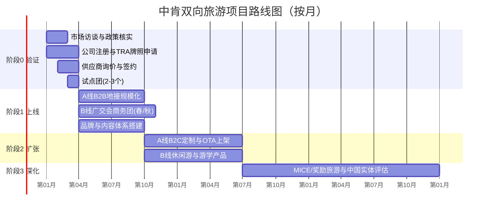

# 中肯双向旅游业务项目计划

> 配套文档：[业务可行性分析](./01-业务可行性分析.md)
> 时间以"第 N 月"表示，第 1 月为项目启动月。建议启动时间选在 **大迁徙旺季（7–10 月）之前 6–9 个月**，以便在第一个旺季前完成准备。

---

## 1. 项目目标

### 1.1 愿景
成为连接中国与肯尼亚的首选双向旅游服务商：让中国游客安心看见真实的东非，让肯尼亚人便捷地走进中国。

### 1.2 SMART 目标（36 个月）

| 目标 | 第 12 月 | 第 24 月 | 第 36 月 |
|---|---|---|---|
| A 线（入肯）累计年服务人次 | 400 | 1,000 | 1,800 |
| B 线（入华）累计年服务人次 | 120 | 300 | 600 |
| 签约国内组团社 | 15 家 | 40 家 | 70 家 |
| 客户满意度（NPS / 评分） | ≥ 4.5/5 | ≥ 4.6/5 | ≥ 4.7/5 |
| A 线 B2C 收入占比 | 10% | 25% | 35% |
| EBITDA | 小幅亏损（≤ US$50k） | 盈利 | 利润率 ≥ 7% |

---

## 2. 阶段规划与里程碑

> 甘特图日期仅为示例（假设 2027 年 1 月启动），实际以启动日期平移。

### 阶段 0：验证期（第 1–3 月）
**目标**：用最小投入验证需求、价格与合规路径。

| 工作项 | 交付物 | 负责人 |
|---|---|---|
| 访谈 20+ 家国内出境组团社（非洲专线、高端定制、摄影游机构） | 需求访谈报告、意向合作名单 | 中国区 BD |
| 访谈 30+ 位肯尼亚潜在客户（贸易商、商会、教会、企业 HR） | B 线需求与价格敏感度报告 | 肯尼亚区销售 |
| 完成可行性分析第 10 节全部核实项 | 更新版可行性分析 | 项目负责人 |
| 内罗毕公司注册、KRA 税号、TRA 牌照申请、KATO 入会申请 | 营业执照、牌照受理回执 | 法务/行政 |
| 营地/酒店/车队/导游询价，签订首个运营季合同价 | 供应商价目表、合作协议 | 产品经理 |
| 与 1–2 家中国入境地接社（广州优先）签约 | B 线地接合作协议 | 中国区 BD |
| 与 1 家持牌出境社签订 B2C 合作协议 | 合作协议 | 中国区 BD |
| 运行 2–3 个试点团（A 线 1–2 个、B 线 1 个） | 试点复盘报告（成本、满意度、问题清单） | 运营经理 |

**关口 1（Go/No-Go，第 3 月末）**——满足以下 4 项中至少 3 项方可进入阶段 1：
- [ ] ≥ 5 家组团社签署地接合作意向或已下单
- [ ] 试点团实际毛利率 ≥ 12%
- [ ] 试点团客户满意度 ≥ 4.3/5，无重大安全/服务事故
- [ ] TRA 牌照获批或处于确定可获批的流程中

### 阶段 1：上线期（第 4–9 月）
**目标**：在第一个大迁徙旺季跑通 A 线 B2B 规模化运营，完成 B 线广交会团。

| 工作项 | 交付物 / 指标 |
|---|---|
| 推出 A 线标准产品 3 条（经典 8 天、大迁徙摄影 10 天、肯坦联游 12 天） | 产品手册（中文）、B2B 报价单 |
| 国内 B2B 推介：线上说明会 + 2 场城市路演（如北京、上海/广州） | 签约组团社 ≥ 15 家 |
| 建立中文导游库（≥ 8 名）并完成服务标准培训 | 导游手册、考核记录 |
| 组织春季/秋季广交会商务团各 1–2 个 | B 线 ≥ 120 人次 |
| 建立签证辅助 SOP 与客户资质审核流程 | SOP 文档、拒签率 ≤ 10% |
| 上线官网（中/英）、微信公众号、小红书、抖音、肯尼亚侧 Facebook/Instagram/TikTok、WhatsApp 商务号 | 渠道账号、内容日历 |
| 上线 CRM + 订单 + 多币种财务流程 | 系统上线，月度对账 |
| 建立 24/7 应急机制（医疗后送、保险理赔、安全通报） | 应急预案、演练记录 |

**关口 2（第 9 月末）**：
- [ ] 旺季服务人次 ≥ 300，且平均毛利率 ≥ 14%
- [ ] 客诉率 ≤ 3%，无未妥善处理的重大事故
- [ ] B 线至少 1 个团盈利且复购/转介绍意向 ≥ 30%

### 阶段 2：扩张期（第 10–18 月）
**目标**：提升利润率（B2C）、拓宽产品线、平滑季节性。

| 工作项 | 交付物 / 指标 |
|---|---|
| A 线 B2C：小红书/抖音内容获客 + 私家定制团（经合作持牌社签约） | B2C 收入占比 ≥ 20% |
| 在 OTA "目的地参团/当地玩乐" 频道上架一日游、热气球、营地套餐 | 上架 ≥ 10 个 SKU |
| 淡季产品：绿季折扣 Safari、蒙巴萨/迪亚尼海滩、桑给巴尔组合 | 淡季人次占比 ≥ 25% |
| B 线新增：上海/北京休闲游、张家界/桂林风光线、高校游学与职业培训考察 | B 线产品 ≥ 5 条 |
| B 线推出 M-Pesa 分期/储蓄计划 | 分期订单占比数据 |
| 与航司谈团队/系列票协议 | 机票成本下降 ≥ 5% |
| 自建或长租 2–3 辆 Safari 车辆（视利用率决定） | 车辆利用率 ≥ 60% |

**关口 3（第 18 月末）**：
- [ ] 滚动 12 个月 EBITDA 为正
- [ ] 滚动 12 个月总人次 ≥ 1,000
- [ ] 评估是否设立中国实体 / 申请旅行社资质（输出决策备忘录）

### 阶段 3：深化期（第 19–36 月）
- 企业奖励旅游、会议会展（MICE）：中资企业驻肯员工及国内企业奖励团
- 在中国设立实体（或收购/参股持牌旅行社），实现 B2C 直接签约
- 拓展东非区域：坦桑尼亚、卢旺达、乌干达（大猩猩）线路
- B 线扩展到乌干达、坦桑尼亚等邻国客源，以内罗毕为东非"赴华"枢纽
- 数据与会员体系：复购、转介绍、摄影社群

---

## 3. 组织与团队

### 3.1 第 1 年团队配置

| 岗位 | 人数 | 驻地 | 职责 |
|---|---|---|---|
| 项目负责人 / 总经理 | 1 | 内罗毕 | 战略、合规、关键合作伙伴、融资 |
| 运营经理（地接） | 1 | 内罗毕 | 供应商、行程执行、应急处理 |
| 中文客服/计调 | 2 | 内罗毕 | 订单、行程单、团队操作、客户沟通 |
| 肯尼亚区销售（B 线） | 1 | 内罗毕 | 商会/贸易商/企业渠道、签证辅助 |
| 中国区 BD（可远程） | 1 | 中国 | 组团社开发、路演、持牌社合作 |
| 内容运营（兼职/外包） | 0.5 | 远程 | 中文短视频、图文、社媒运营 |
| 财务会计（外包） | — | 内罗毕 | 记账、税务、多币种对账 |
| 中文导游 | 按团聘用 | 肯尼亚 | 带团（自由职业 + 培训认证） |

### 3.2 治理
- 每周：运营例会（订单、团期、风险）
- 每月：经营分析会（KPI、现金流、渠道 ROI）
- 每个关口：Go/No-Go 评审会，形成书面决策

---

## 4. 预算与资金计划

| 阶段 | 期间 | 主要支出 | 预算（US$） |
|---|---|---|---|
| 阶段 0 | 第 1–3 月 | 注册与牌照、访谈与考察、试点团补贴、核心团队 | 60,000 |
| 阶段 1 | 第 4–9 月 | 团队、路演与展会、内容与系统、营运资金（旺季预付） | 150,000 |
| 阶段 2 | 第 10–18 月 | 团队扩充、B2C 投放、车辆（可选）、新产品踩线 | 140,000 |
| **合计（至第 18 月）** | | | **≈ 350,000** |

- **资金节奏**：首期到位 US$150,000（覆盖阶段 0 + 阶段 1 前半段），关口 1 通过后释放第二期 US$200,000。
- **现金流管理**：B2B 客户收取团款 30–50% 预付；旺季营地需提前 60–90 天付订金，营运资金需求在第 5–7 月达到峰值。

---

## 5. 关键绩效指标（KPI）

| 类别 | KPI | 目标值 |
|---|---|---|
| 增长 | 月度服务人次、签约组团社数、B2C 线索量 | 见第 1.2 节 |
| 盈利 | 分产品毛利率、单人毛利、渠道获客成本（CAC） | 毛利率 ≥ 15%；B2C CAC ≤ 单人毛利 30% |
| 质量 | 客户满意度、客诉率、导游评分 | ≥ 4.5/5；≤ 3% |
| 运营 | 供应商准时率、车辆利用率、签证通过率 | ≥ 98%；≥ 60%；≥ 90% |
| 现金 | 预收款覆盖率、应收账款周转天数 | ≥ 40%；≤ 30 天 |
| 安全 | 安全事故数、应急响应时间 | 0 重大事故；≤ 30 分钟响应 |

---

## 6. 风险管理计划

| 风险 | 预警信号 | 应对预案 | 负责人 |
|---|---|---|---|
| 政治/安全事件 | 使馆安全提醒、大规模抗议 | 启动改线/延期方案，48 小时内通知全部在途和待出发客户 | 运营经理 |
| 需求不及预期 | 关口 KPI 未达标 | 缩减固定成本，转为纯 B2B 地接或聚焦单线 | 总经理 |
| 签证政策变化 | 拒签率上升 / 新政策发布 | 调整材料清单，提前出签时间；利好时快速推出新产品 | 肯尼亚区销售 |
| 供应商涨价/超售 | 合同价变更通知 | 多家备选供应商，合同锁价 | 产品经理 |
| 现金流紧张 | 预付款覆盖率 < 30% | 提高预收比例、旺季授信额度 | 总经理/财务 |
| 舆情事件 | 社媒负面帖 | 24 小时内响应，事实核查，补偿方案 | 内容运营 |

---

## 7. 近期行动清单（启动后前 30 天）

- [ ] 确认项目负责人、首期资金与股权结构
- [ ] 聘请肯尼亚本地律师与会计，启动公司注册与 TRA 牌照申请
- [ ] 完成可行性分析中 11 项假设核实的分工与时间表
- [ ] 制作访谈提纲（组团社版 / 肯尼亚客户版）并开始访谈
- [ ] 向 10 家以上营地/酒店、3 家车队、2 家入境地接社发出询价
- [ ] 确定品牌名、注册域名与社媒账号
- [ ] 设计 2–3 个试点团产品与报价，锁定试点团期（优先大迁徙季之前的窗口或广交会）
- [ ] 建立项目看板（任务、负责人、截止时间）与每周例会机制
