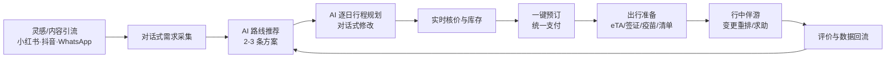
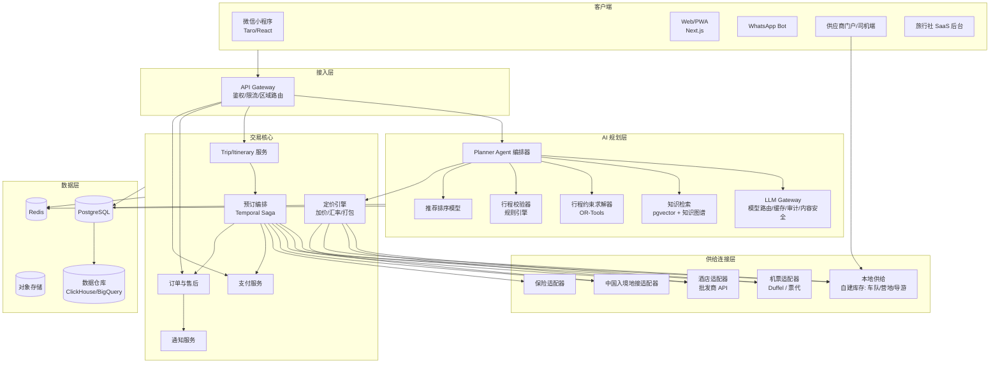
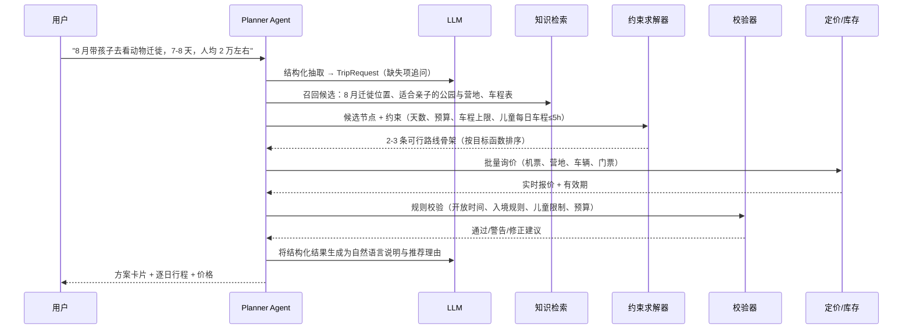
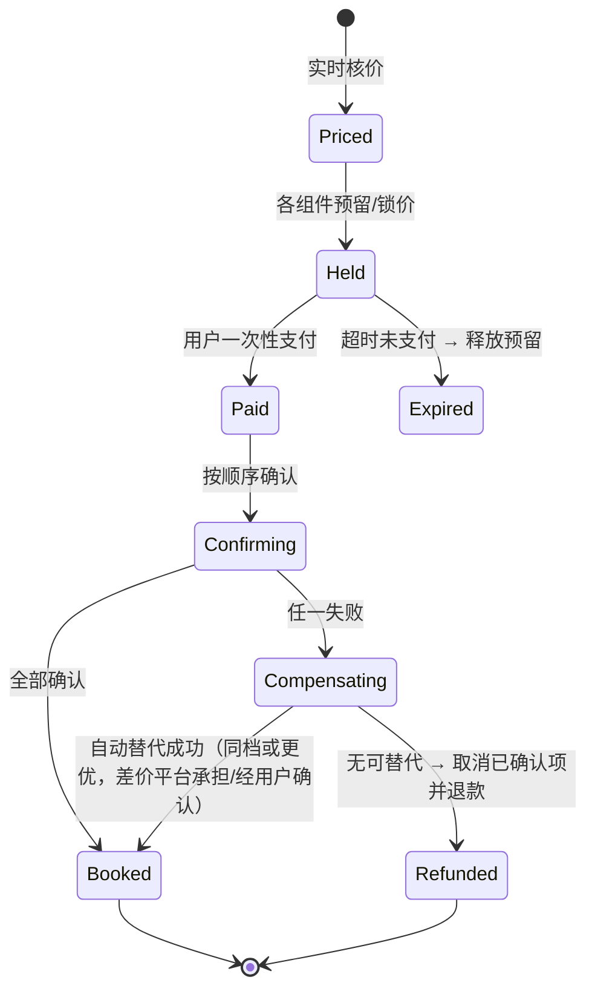

# AI 产品与技术架构

> 配套：[03-轻资产技术主导业务方案](./03-轻资产技术主导业务方案.md)、[05-研发与上线计划](./05-研发与上线计划.md)
> 核心能力：**AI 路线推荐 → AI 行程规划 → 一键机酒车预订 → 行中服务**

---

## 1. 设计原则

1. **LLM 负责"理解与表达"，确定性系统负责"事实与可行性"**：价格、库存、车程、开放时间、签证政策都不由大模型生成，而是来自工具调用和知识库，并由规则校验。
2. **每个行程都是可执行的结构化对象**（Itinerary JSON），而不是一段文字；文字只是它的渲染结果。
3. **先预留后支付，失败可补偿**：一键预订是一个分布式事务，用 Saga 编排而非"挨个下单碰运气"。
4. **供应商可替换**：机票、酒店、用车、支付都走抽象层，任一供应商可以替换或并行。
5. **双区部署、数据分级**：中国用户数据在中国区，境外供应商只拿下单必需字段。
6. **两条线一套系统**：目的地（肯尼亚/中国）是配置与知识库，而不是代码分支。

## 2. 用户旅程与功能拆解



| 阶段 | MVP 功能 | 后续功能 |
|---|---|---|
| 需求采集 | 对话 + 快捷卡片（月份、天数、人数、预算、风格） | 语音输入、截图/攻略链接解析（"按这篇小红书帮我订"） |
| 路线推荐 | 基于知识库 + 求解器生成 2–3 条，附理由与估价 | 个性化排序（历史行为、相似用户） |
| 行程规划 | 逐日时间轴、地图、住宿与车辆安排、对话修改 | 多人协同编辑、定制师介入 |
| 核价预订 | 机票 + 酒店/营地 + Safari 用车 + 接送机 + 门票 | 保险、热气球、摄影跟拍、中国高铁、展会注册 |
| 出行准备 | 材料清单、表单填写辅助、提醒 | 签证进度跟踪（与代办合作方对接） |
| 行中 | 消息提醒、司机信息、紧急联系 | 航班延误自动重排、实时翻译、动物目击地图 |

## 3. 系统总体架构



### 3.1 技术选型

| 层 | 选型 | 理由 |
|---|---|---|
| 后端主语言 | **Python（FastAPI）** 用于 AI/求解器；**TypeScript（NestJS）** 用于交易与 BFF（也可全部 Python 以减少栈） | AI 生态 + 前后端共享类型 |
| 工作流 | **Temporal** | 长事务、重试、补偿、可观测，天然适合预订 Saga |
| 数据库 | PostgreSQL + PostGIS + pgvector | 地理计算、向量检索、事务一个库搞定，早期运维简单 |
| 缓存/队列 | Redis；事件总线用 Redis Streams（早期）→ Kafka（规模化后） | 先简单后扩展 |
| 求解器 | Google OR-Tools（CP-SAT） | 时间窗、行驶时长、预算约束 |
| 前端 | 小程序 Taro（React 语法）；Web 用 Next.js；共享组件与 Itinerary 渲染 | 一套组件多端复用 |
| 地图 | 中国区：高德/腾讯地图；境外：Mapbox/Google Maps；Safari 车程用自建路网时长表 | 公园内道路在商业地图上不准 |
| 部署 | **中国区**：阿里云/腾讯云（ICP 备案）；**国际区**：AWS/GCP（如 af-south-1 或欧洲区） | 数据合规与延迟 |
| 可观测性 | OpenTelemetry + Grafana/Prometheus + Sentry；LLM 追踪用 Langfuse（可自托管） | 端到端追踪 AI 和预订链路 |
| 基础设施即代码 | Terraform + GitHub Actions | 两区一致部署 |

## 4. 数据与知识层（壁垒核心）

### 4.1 目的地知识图谱
| 实体 | 关键属性 | 数据来源 |
|---|---|---|
| 区域/公园（Park） | 坐标、开放时间、门票（含季节价、居民/非居民价）、游猎规则 | 官方公告 + 人工维护，带生效/过期日期 |
| 景点/活动（POI/Activity） | 时长、最佳时段、适合人群、季节性评分 | 编辑团队 + 供应商 |
| 住宿（Lodge/Hotel） | 位置（公园内/外）、档次、中文友好度、餐食（是否有中餐）、库存来源 | 批发商 API + 自签营地 |
| 路段（RouteEdge） | 起终点、**实测行驶时长**（分季节、分路况）、路面类型 | 司机端 GPS 回传 + 人工校正 |
| 季节事件（SeasonEvent） | 如"大迁徙位置（按月/按周）"、过河概率、雨季 | 导游与司机实时上报 + 历史数据 |
| 入境规则（EntryRule） | eTA/签证、疫苗、过境要求，**适用国籍**、生效日期、来源链接 | 法规监测 + 人工审核，过期强制复核 |

### 4.2 核心数据模型（简化）

```text
User(id, region[CN|INTL], locale, nationality, preferences_json)
TripRequest(id, user_id, origin_city, month|date_range, days, travelers[{age_group}], budget_range, styles[], must_have[], avoid[])
Itinerary(id, trip_request_id, version, status[draft|priced|held|booked|cancelled], total_price, currency, valid_until)
ItineraryDay(itinerary_id, day_no, date, base_location_id)
ItineraryItem(id, day_id, type[flight|stay|transfer|safari_drive|activity|meal|free], start, end,
              ref_entity_id, supplier_offer_id, price, refund_policy, status)
SupplierOffer(id, supplier, product_type, raw_payload, price, currency, expires_at, hold_token?)
Booking(id, itinerary_id, saga_id, payment_id, status)
BookingLeg(id, booking_id, item_id, supplier, supplier_ref, status[pending|held|confirmed|failed|cancelled|refunded])
LocalSupplier(id, type[vehicle_operator|lodge|guide|ground_handler], license_no, license_expiry, rating, payout_account)
Vehicle(id, supplier_id, type[4x4_popup|landcruiser|van], seats, window_seats, chinese_speaking_driver:boolean)
AvailabilityCalendar(resource_id, date, capacity, booked, price_rule_id)
Sighting(id, reporter_id, location, species, count, observed_at)  -- 司机端上报
```

### 4.3 Itinerary JSON（AI 与前端的统一契约）

```json
{
  "itinerary_id": "itn_8f2c",
  "destination": "KE",
  "dates": { "start": "2027-08-12", "end": "2027-08-19" },
  "travelers": [{ "type": "adult", "count": 2 }, { "type": "child", "age": 10, "count": 1 }],
  "summary": "8 天亲子大迁徙：纳库鲁湖 + 马赛马拉 3 晚 + 安博塞利",
  "days": [
    {
      "day": 3,
      "base": "masai_mara",
      "items": [
        { "type": "safari_drive", "start": "06:30", "end": "10:30",
          "vehicle": { "offer_id": "veh_off_123", "type": "4x4_popup", "window_seat_per_person": true } },
        { "type": "meal", "start": "12:00", "note": "营地午餐，可预订中式简餐" },
        { "type": "safari_drive", "start": "15:30", "end": "18:30",
          "hint": "本周迁徙主力在马拉河北岸，过河概率高" },
        { "type": "stay", "offer_id": "htl_off_987", "name": "示例营地", "refund_policy": "入住前 30 天免费取消" }
      ]
    }
  ],
  "pricing": { "currency": "CNY", "total": 68400, "price_valid_until": "2027-05-02T12:00:00Z",
               "breakdown_visible": ["flight"], "bundled": ["stay", "vehicle", "park_fees"] },
  "checks": { "feasible": true, "warnings": ["需提前办理肯尼亚 eTA", "建议接种黄热病疫苗"] }
}
```

## 5. AI 规划引擎设计

### 5.1 流水线



### 5.2 各组件职责

| 组件 | 实现 | 说明 |
|---|---|---|
| **意图理解与槽位抽取** | LLM 函数调用（JSON Schema 输出） | 抽取月份、天数、预算、人群、偏好；必要信息缺失时只追问 1–2 个关键问题 |
| **候选召回** | 知识图谱查询 + 向量检索 | 按季节评分、人群适配、预算档次召回节点；向量检索用于"类似这篇攻略"的语义匹配 |
| **路线骨架求解** | OR-Tools CP-SAT | 变量：每晚驻地；约束：总天数、相邻驻地车程/航段、每日最大车程、必去点、营地档次与预算；目标：体验得分 − 车程惩罚 − 价格偏差 |
| **体验得分** | 初期规则权重 → 中期学习排序模型（LightGBM/LTR） | 特征：季节事件（迁徙位置）、人群适配、用户偏好、历史转化与评价 |
| **逐日排程** | 启发式 + 时间窗约束 | 游猎在清晨/傍晚，午间休息；国际航班落地当天不安排长途 |
| **校验器** | 规则引擎（如 JSON Logic / 自写 DSL），规则带版本与生效期 | 例：公园关门时间、儿童是否允许参加步行游猎、热气球年龄限制、eTA 提前量 |
| **对话式修改** | LLM 将"轻松一点"翻译为约束变更（如每日最大车程 5h→3h）后重新求解 | 保证修改后的行程依然可行 |
| **解释生成** | LLM 基于结构化结果写说明，禁止引入结构化结果之外的事实 | 输出后做"事实一致性检查"（价格、日期、名称与 JSON 比对） |

### 5.3 LLM 网关与模型策略
- **双区模型路由**：中国区调用已备案国产模型（如通义千问 / DeepSeek / 文心）；国际区可用 GPT / Claude / Gemini 等。业务代码只调用统一网关接口。
- **分级用模**：槽位抽取、改写用小模型（低成本、低延迟）；复杂规划解释用大模型。
- **缓存**：相同目的地+月份+人群的候选召回和骨架结果缓存（行程骨架缓存 24h，价格不缓存或仅缓存数分钟）。
- **内容安全与审计**：输入输出过滤，全部调用留痕（合规 + 评估）。
- **成本目标**：一次完整规划（含 2–3 轮修改）≤ US$0.30。

### 5.4 质量评估体系（上线门槛）

| 指标 | 定义 | 上线门槛 |
|---|---|---|
| 可执行率 | 生成行程通过校验器且所有组件可询到价 | ≥ 98% |
| 事实一致率 | 文本说明与结构化数据一致（自动比对） | ≥ 99.5% |
| 预算命中率 | 报价在用户预算 ±15% 内 | ≥ 85% |
| 专家评分 | 资深导游/定制师盲评 1–5 分 | ≥ 4.2 |
| 首屏响应时长 | 用户提交到第一版方案 | P50 ≤ 15s，P95 ≤ 40s（先出骨架再流式补价格） |
| 规划→下单转化 | — | MVP ≥ 2%，第 2 年 ≥ 4% |

建立 **300+ 条标准测试需求集**（覆盖月份 × 人群 × 预算 × 天数），每次模型/提示词/规则变更跑回归。

## 6. 一键预订编排（机 + 酒 + 车）

### 6.1 状态机



### 6.2 编排顺序与策略

| 步骤 | 说明 |
|---|---|
| 1. 重新核价 | 用户点击"一键预订"时并行刷新所有报价；价格变动超阈值（如 >2%）需用户确认 |
| 2. 预留 | 酒店/营地：可预留的先 hold；本地车辆：在自建库存日历中锁定（TTL 30 分钟）；机票：创建订单并保留座位（视供应商能力） |
| 3. 支付 | 一次扣款（或预授权）；支付成功后进入确认阶段 |
| 4. 确认顺序 | **最难替代、最贵、库存最紧张的先确认**：通常为热门营地 → 机票出票 → 车辆 → 门票 → 保险 |
| 5. 补偿 | 任一步失败：先调用"替代方案搜索"（同区域同档次）；不成功再按逆序取消已确认项；不可退部分由平台兜底基金承担并记录 |
| 6. 本地供应商确认 SLA | 车队/营地 2 小时内确认（门户/WhatsApp 一键确认），超时自动转备用供应商 |

### 6.3 技术实现要点
- 每个 BookingLeg 是 Temporal Activity，**幂等键** = `booking_id + leg_id`，防重复下单。
- 所有供应商调用记录原始请求/响应（脱敏）以便对账与纠纷处理。
- 订单变更（改期、退订）同样走 Saga，规则按组件的退改政策自动计算可退金额。
- 每日自动对账：订单 ↔ 供应商确认 ↔ 支付流水 ↔ 结算。

## 7. 供给连接层

### 7.1 统一适配器接口

```text
interface SupplierAdapter {
  search(query) -> Offer[]
  price(offer_id) -> PricedOffer          // 刷新价格与有效期
  hold(offer_id, travelers) -> HoldToken  // 不支持时返回 NOT_SUPPORTED
  confirm(hold_or_offer, payment_ref) -> SupplierBookingRef
  cancel(supplier_ref) -> RefundQuote
  status(supplier_ref) -> BookingStatus
}
```

### 7.2 供应商规划 ⚠商务条款与可用性待核实

| 品类 | A 线（入肯） | B 线（入华） | MVP 方案 |
|---|---|---|---|
| 国际机票 | 机票聚合 API（如 Duffel，含 NDC 内容）或国内持资质票代 API | 同左（内罗毕出发） | 一家聚合商 + 一家票代备份 |
| 酒店 | 酒店批发商 API（如 Hotelbeds、WebBeds、Expedia Rapid 等择一） | 同左，或携程分销/联盟 | 一家批发商 |
| 营地（Safari Lodge/Tented Camp） | 批发商覆盖不全 → **自签 + 供应商门户自建库存** | — | 首批签约 20–30 家马赛马拉/安博塞利/纳库鲁营地 |
| 用车 | **自建**：Safari 车队、接送机（供应商门户 + 司机端 App） | 入境地接社适配器；城市打车引导使用滴滴等国际版 | 首批签约 5–8 家 TRA 持牌车队 |
| 导游 | 自建中文导游库（认证 + 评分） | 英语/斯瓦希里语陪同（地接社提供） | 20 名中文导游 |
| 门票 | 由车队代购或对接官方电子票系统 ⚠待核实接口 | 景区门票随地接打包 | 车队代购，平台结算 |
| 高铁/国内段 | — | 12306 无开放接口 → 通过持资质分销商或地接代订 | 第二阶段 |
| 签证/eTA | 材料清单 + 表单填写辅助（不代用户提交官方系统，除非有授权合作方） | 同左，与签证服务合作方对接 | 指南 + 清单 + 提醒 |
| 保险 | 境外旅行险 API（国内持牌保险平台） | 肯尼亚本地保险合作 | 第二阶段 |

### 7.3 供应商门户与司机端（本地数字化）
- **门户**（Web，英文）：资质上传与到期提醒、车辆/房型、库存日历、价格规则（季节、人数阶梯）、订单确认、结算单。
- **WhatsApp 集成**：新订单推送 → 供应商回复"1 确认 / 2 拒绝"即完成确认，降低使用门槛。
- **司机端 App**（Android 优先，离线可用）：行程单、客人信息、导航、**动物目击一键上报**（含照片与定位，计入激励）、GPS 轨迹（用于路段实测时长）。
- **结算**：M-Pesa / 银行转账，T+3 自动结算，快速回款是吸引供应商入驻的核心卖点。

## 8. 支付与资金流

| 场景 | 方案 ⚠需核实各渠道对主体与行业的准入要求 |
|---|---|
| 中国用户 | 微信支付/支付宝（中国主体或合作持牌社收款，或境外商户跨境收单）；银联卡 |
| 肯尼亚用户 | M-Pesa（Safaricom Daraja API）、本地支付聚合商（如 Flutterwave、Paystack、Pesapal）、Visa/Mastercard |
| 供应商结算 | 肯尼亚：M-Pesa B2C / 本地银行；国际供应商：美元电汇或虚拟卡（VCC） |
| 多币种 | 账务本位币 USD；展示币种 CNY/KES；报价锁汇有效期与价格有效期一致 |
| 资金安全 | 用户资金尽量由支付渠道或合同主体托管，按供应商确认节点结算，平台不形成资金池 ⚠法律确认 |

## 9. 安全、隐私与合规技术措施
- **数据分级**：护照号、出生日期、健康信息为敏感级，字段级加密（KMS），访问留痕；默认只在下单时向必要供应商传递。
- **双区隔离**：中国区与国际区数据库物理隔离；跨区只同步脱敏的业务数据（如订单状态、行程骨架），需传护照信息的跨境下单单独授权。
- **AI 合规**：中国区仅使用已备案模型，内容安全审核，生成内容标识；用户可查看和删除对话数据。
- **应用安全**：OWASP Top 10 防护、供应商 API 密钥集中管理（Vault/云 KMS）、支付合规（不落卡号，使用渠道托管页/令牌化）。

## 10. 非功能指标

| 项 | 目标 |
|---|---|
| 可用性 | 交易链路 99.9%，规划链路 99.5% |
| 规划延迟 | P50 ≤ 15s（流式输出，3s 内出现首个内容） |
| 预订编排 | 95% 订单 5 分钟内完成全部确认（本地供应商除外，SLA 2h） |
| 价格准确 | 下单价与展示价不一致率 < 0.5% |
| 扩展性 | 新目的地上线只需新增知识库、规则与供应商配置（目标 ≤ 6 周） |

## 11. 代码仓库与服务划分（建议）

```text
kenyaTrip/
├── apps/
│   ├── miniprogram/          # 微信小程序（Taro）
│   ├── web/                  # Next.js Web/PWA + 旅行社 SaaS 后台
│   ├── supplier-portal/      # 供应商门户
│   └── driver-app/           # 司机端（React Native）
├── services/
│   ├── planner/              # Python: Agent 编排、求解器、校验器、排序
│   ├── llm-gateway/          # 模型路由、缓存、审计、内容安全
│   ├── trip/                 # 行程与版本管理
│   ├── pricing/              # 定价、汇率、打包
│   ├── booking/              # Temporal workflows（Saga）
│   ├── payment/              # 支付渠道适配
│   ├── supply/               # 供应商适配器 + 本地库存
│   └── messaging/            # 通知、WhatsApp、企业微信
├── packages/
│   ├── itinerary-schema/     # Itinerary JSON Schema 与类型（多端共享）
│   └── ui/                   # 共享组件（行程时间轴、地图卡片）
├── knowledge/                # 目的地知识库（YAML/CSV，版本化，PR 审核）
├── evals/                    # 300+ 规划测试集与评估脚本
└── infra/                    # Terraform（cn-region / intl-region）
```

> 知识库放在仓库中以 PR 方式维护（尤其门票、入境规则等），确保每次变更可审计、可回滚，并自动触发评估回归。
