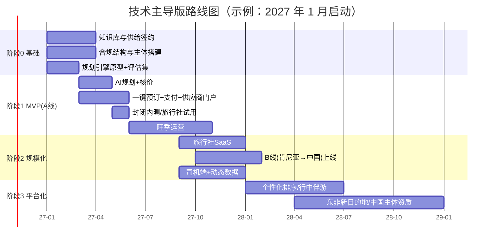

# 研发与上线计划（技术主导版）

> 替代 [02-项目计划](./02-项目计划.md) 中以自营团队为核心的路线图。
> 配套：[03-轻资产技术主导业务方案](./03-轻资产技术主导业务方案.md)、[04-AI产品与技术架构](./04-AI产品与技术架构.md)
> 时间以"第 N 月"表示。目标是让 **MVP 在第一个大迁徙旺季（7–10 月）前至少 2 个月上线**，因为中国游客通常提前 2–4 个月预订。

---

## 1. 总体路线图

## 2. 阶段 0：基础（第 1–3 月）

| 工作流 | 交付物 | 验收标准 |
|---|---|---|
| **规划引擎原型** | 命令行/内部页面版：输入需求 → 输出可行行程骨架（无真实价格） | 50 条测试需求中专家评分 ≥ 3.8 |
| **评估集** | 300 条标准需求 + 专家标注的"好行程"要素 | 可自动跑回归 |
| **知识库 v1** | 肯尼亚 6 大区域、30+ 营地/酒店、主要路段实测时长、门票（含季节价）、入境规则 | 每条数据有来源与生效日期 |
| **供给签约** | 5 家车队、20 家营地签约并录入库存；1 家机票聚合商、1 家酒店批发商完成商务与沙箱接入 | 沙箱可完成 search/price/book |
| **合规** | 肯尼亚公司 + TRA 牌照申请；与 1–2 家国内持牌出境社签订技术合作；律师出具结构意见；中国区 AI 模型与应用登记路径确认 | 书面法律意见 |
| **基础设施** | 两区云账号、CI/CD、Terraform、可观测性基线 | 一键部署到 staging |

**关口 1（第 3 月末）**：规划原型评分达标 + 供给签约达标 + 法律结构可行，方可投入 MVP 全量开发。

## 3. 阶段 1：MVP，仅 A 线（第 3–6 月开发，第 6–10 月旺季运营）

### 3.1 MVP 范围（只做最能验证价值的部分）

| 包含 | 不包含（推迟） |
|---|---|
| 微信小程序 + H5：对话式需求采集、2–3 条路线推荐、逐日行程、对话修改 | 原生 App、语音、攻略截图解析 |
| 实时核价：机票、酒店/营地、Safari 车辆、门票 | 保险、热气球等增值项（可人工补单） |
| 一键预订 Saga：预留 → 支付 → 确认 → 补偿 | 自动改期（MVP 由客服人工处理） |
| 供应商门户 + WhatsApp 确认 | 司机端 App |
| 出行准备：eTA/疫苗/材料清单与提醒 | 签证进度跟踪 |
| 客服后台（AI 辅助回复 + 人工接管） | 旅行社 SaaS |
| 合规结构：打包产品以持牌出境社为合同主体 | 中国自有主体收款 |

### 3.2 迭代节奏（2 周一个迭代）

| 迭代 | 主要内容 |
|---|---|
| S1 | Itinerary Schema、行程服务、LLM 网关、槽位抽取 |
| S2 | 求解器接入知识库、校验器、行程渲染（小程序时间轴 + 地图） |
| S3 | 供应商适配器（机票、酒店、本地库存）、定价引擎 |
| S4 | Temporal 预订编排、支付接入、订单与通知 |
| S5 | 供应商门户、WhatsApp 确认、客服后台 |
| S6 | 评估回归、压测、安全测试、封闭内测（50 位种子用户 + 3 家旅行社） |

### 3.3 MVP 成功标准（关口 2，第 10 月末）

| 指标 | 目标 |
|---|---|
| 完成规划的用户数 | ≥ 8,000 |
| 下单数 | ≥ 200 单（约 400 人次） |
| 规划→下单转化 | ≥ 2% |
| 一键预订自动完成率（无需人工介入） | ≥ 85% |
| 预订失败导致的退款率 | ≤ 2% |
| 行后评分 | ≥ 4.5/5 |
| 单均净收入 | ≥ US$450 |

未达标的处理：如转化低而评分高 → 加大获客与 SaaS 渠道；如自动完成率低 → 优先补供给数字化；如评分低 → 暂停投放，修复规划与履约质量。

## 4. 阶段 2：规模化（第 9–13 月）

| 工作流 | 内容 | 目标 |
|---|---|---|
| **旅行社 SaaS** | 白标规划器、报价单导出（带品牌）、团队协作、按单分佣结算 | 签约 30 家旅行社，SaaS 贡献 ≥ 25% 订单 |
| **B 线上线** | 中国目的地知识库（广州、深圳、义乌、上海、北京、桂林、张家界）、广交会行程模板、签证材料助手、中国支付/出行指南、WhatsApp 预订 + M-Pesa | 秋季广交会 ≥ 80 单 |
| **司机端 + 动态数据** | 离线行程单、目击上报、GPS 路段时长 | 70% 订单车辆使用司机端；迁徙位置数据按日更新 |
| **增值品类** | 保险、热气球、摄影跟拍、蒙巴萨/桑给巴尔延伸 | 增值收入占比 ≥ 8% |
| **内容引擎** | AI 生成攻略 → 发布到小红书/抖音 → "一键带走行程"深链 | 内容渠道获客 CAC ≤ US$80 |

## 5. 阶段 3：平台化（第 13–24 月）
- 学习排序模型替代规则权重；基于历史订单的个性化推荐
- 行中伴游：航班延误自动重排、实时翻译、紧急求助
- 新目的地：坦桑尼亚（塞伦盖蒂/桑给巴尔）、卢旺达/乌干达（大猩猩）；验证"新目的地上线 ≤ 6 周"
- 视规模设立中国主体，申请或收购旅行社资质，实现 C 端直接签约收款
- B 线扩展客源到乌干达、坦桑尼亚等东非国家

## 6. 团队配置

### 6.1 第 1 年（约 10–11 人，技术占比 ≥ 60%）

| 岗位 | 人数 | 驻地 | 职责 |
|---|---|---|---|
| CEO（业务/融资/合规） | 1 | 内罗毕/中国 | 战略、合作伙伴、融资 |
| CTO / 技术负责人 | 1 | 远程（中国） | 架构、AI 规划引擎、团队 |
| 后端工程师（交易/供应商集成） | 2 | 远程 | 预订编排、适配器、支付 |
| AI/算法工程师 | 1 | 远程 | LLM 网关、求解器、评估体系 |
| 前端工程师（小程序 + Web） | 1 | 远程 | C 端、门户、SaaS 后台 |
| 产品经理 / 设计 | 1 | 远程 | 用户研究、交互、知识库规范 |
| 目的地知识编辑（兼数据运营） | 1 | 内罗毕 | 知识库维护、门票/规则更新、营地探访 |
| 供给拓展经理 | 1 | 内罗毕 | 车队/营地/导游签约与培训 |
| 用户运营/客服（AI 辅助） | 1–2 | 中国 | 内容、社群、客诉、人工接管 |

> 肯尼亚工程师资源（内罗毕技术生态成熟）可用于门户、司机端与 B 线，兼顾成本与本地理解。

### 6.2 外部合作
- 法律：中国（旅游与 AI 合规）、肯尼亚（TRA、数据保护）各 1 家律所
- 持牌出境社 1–2 家（合同主体）、中国入境地接社 1–2 家（B 线）
- 会计与税务外包

## 7. 预算（至第 18 个月，US$）

| 类别 | 阶段 0–1（第 1–10 月） | 阶段 2（第 11–18 月） | 合计 |
|---|---|---|---|
| 研发人力 | 300k | 260k | 560k |
| 业务与运营人力 | 90k | 90k | 180k |
| 云、模型调用、第三方 API | 25k | 35k | 60k |
| 市场获客与内容 | 70k | 150k | 220k |
| 法律、牌照、主体设立 | 40k | 20k | 60k |
| 供给拓展（探访、培训、激励） | 20k | 20k | 40k |
| 兜底基金（预订失败补偿） | 10k | 20k | 30k |
| **合计** | **555k** | **595k** | **≈ 1.15M** |

- 种子轮 US$500–600k 覆盖阶段 0–1；关口 2 通过后启动 Pre-A（US$0.8–1M）。
- 降本选项：研发外包部分前端；MVP 用全 Python 单体（模块化）替代微服务；LLM 先只接一家国产 + 一家国际模型。

## 8. KPI 看板

| 层级 | 指标 |
|---|---|
| 北极星 | **月度完成预订的出行人次** |
| 漏斗 | 访客 → 发起规划 → 完成规划 → 加购/预留 → 支付 → 出行 → 评价/复购 |
| AI 质量 | 可执行率、事实一致率、预算命中率、专家评分、规划延迟、单次规划成本 |
| 交易 | 一键自动完成率、价格不一致率、退款率、供应商确认 SLA 达成率 |
| 供给 | 数字化供应商数、库存覆盖率（热门日期可售比例）、供应商 NPS、结算准时率 |
| 财务 | GMV、Take rate、单均净收入、CAC、回收期、现金跑道 |

## 9. 风险与应对（研发侧）

| 风险 | 应对 |
|---|---|
| 旺季前 MVP 延期 | 范围冻结在第 3.1 节；预订编排兜底为"AI 规划 + 人工代订"，保证旺季可运营 |
| 供应商 API 接入周期长（商务审批、认证） | 第 1 月即启动商务；每品类准备备选供应商 |
| AI 行程质量不稳定 | 评估集回归作为发布门禁；高价订单（如 > ¥80,000）人工复核 |
| 本地供应商不使用门户 | WhatsApp 确认 + 供给经理现场培训 + 快速结算激励 |
| 中国区 AI/支付合规受阻 | 早期以合作持牌社小程序与收款为主，平台作为技术服务商 |

## 10. 启动后前 30 天行动清单

- [ ] 确认 CTO 与核心研发团队（至少后端 1 + AI 1 到位）
- [ ] 律师启动合规结构意见：组件代订 / 持牌社合同主体 / 跨境收款 / AI 登记
- [ ] 与 3 家机票聚合商或票代、3 家酒店批发商发起商务沟通，申请沙箱
- [ ] 在马赛马拉、安博塞利、纳库鲁走访并签约首批营地与车队（意向书）
- [ ] 定义 Itinerary JSON Schema v1 与知识库数据规范
- [ ] 搭建评估集（首批 100 条）并邀请 3 位资深导游/定制师做标注
- [ ] 完成规划引擎第一个可运行原型（知识库 + 求解器 + LLM 解释）
- [ ] 两区云账号、代码仓库结构（见 04 第 11 节）、CI/CD 初始化
- [ ] 与 2 家国内持牌出境社洽谈技术合作与 SaaS 试用
